# The Applied AI Field Guide

**Decide what AI should do, prove it does the job, and give the team what it needs to run it.**

[](https://github.com/davidahma/ai-guide/actions/workflows/validate.yml)
[](LICENSE)

The brief says “automatically correct and post invoices.” The reviewer shows you the rule that requires approval first. The [worked invoice engagement](examples/invoice-exception/engagement/README.md) follows that decision to a narrower test, with deployment still on hold. Use the [reframing playbook](playbooks/00-field-engagement-and-reframing.md) when the brief doesn’t match the work.

[Start in five minutes](guide/field-guide-in-five-minutes.md) · [Decide what to fund](guide/funding-ai-for-accepted-outcomes.md) · [Review a failure path](examples/invoice-exception/durable-recovery/README.md) · [Try a practice exercise](examples/invoice-exception/document-review/practice.md)

## Start with the job in front of you

| You need to… | Start here | Leave with |
| --- | --- | --- |
| **Decide what to fund** | [Executive funding guide](guide/funding-ai-for-accepted-outcomes.md) and the [scorecard](guide/ai-value-engineering-scorecard.md) | One next test, what stays blocked, and who decides |
| **Review an inherited system** | [Application and platform baseline](templates/production-service-readiness.md#application-and-platform-baseline) | What the platform already proves, what still needs checking, and when to recheck |
| **Decide where AI could help** | [Discovery and Value](playbooks/01-discovery-and-value.md), then [mechanism selection](library/12-software-architecture-and-intelligence-selection.md) | An observed decision, accepted outcome, verifier, value hypothesis, and simplest plausible mechanism |
| **Build a useful first feature** | [Build one vertical slice](playbooks/02-solution-and-delivery.md#5-build-a-vertical-slice) and try the [invoice review lab](examples/invoice-exception/document-review/README.md) | One bounded path through real inputs, a usable review surface, failure behavior, and test cases |
| **Fix weak retrieval or unsupported answers** | [Context and knowledge systems](library/02-context-and-knowledge-systems.md) and the [retrieval evaluation lab](examples/invoice-exception/retrieval-evaluation/README.md) | Separate evidence for retrieval, source support, permissions, freshness, abstention, latency, and cost |
| **Make a retry or recovery path safe** | [Enterprise integration reality](library/17-enterprise-integration-and-scale-reality.md) and the [durable recovery lab](examples/invoice-exception/durable-recovery/README.md) | A stable operation identity, explicit ambiguity, source-of-truth readback, and an escalation path instead of a duplicated effect |
| **Test a model, prompt, source, or policy change** | [Wrong-amount change walkthrough](examples/invoice-exception/document-review/README.md#from-a-failed-case-to-a-proposed-change), then [production evaluation](library/04-production-evaluation-and-governance.md) and [change impact](templates/change-impact-assessment.json) | A source-owned case, candidate fix, neighboring regressions, dependencies, and a release decision |
| **Launch or operate a system** | [Production readiness](templates/production-service-readiness.md) and [production operations](operations/README.md) | The missing evidence or capability, its owner, and a release, repair, constraint, pause, or retirement decision |
| **Staff the next test** | [Capability roadmap](guide/capability-roadmap.md#staff-the-workflow-you-have) | Named people, decision rights, available reviewer time, and a backup |

## Choose your depth

| Layer | Use it for | Entry |
| --- | --- | --- |
| **The Guide** | The delivery method | [Five-minute Guide](guide/field-guide-in-five-minutes.md), then [concise Guide](guide/README.md) |
| **Handbook** | Running a live engagement | [Lifecycle playbooks](playbooks/README.md) |
| **Engineering Kit** | Contracts, controls, and executable evidence | [Templates](templates/README.md), [controls](controls/control-catalog.json), and [examples](examples/invoice-exception/README.md) |

They are not separate frameworks.

## The core idea

Start with the work and the accepted outcome, not a model or agent topology. Compare deterministic software, optimization, classical ML, retrieval, a foundation-model call, a bounded agent workflow, and human review. Choose the smallest mechanism that can safely do the job.

Use the [12 Factors of AI Value Engineering](library/14-twelve-factors-ai-value-engineering.md) and [one-page scorecard](guide/ai-value-engineering-scorecard.md) to name the outcome, who can verify it, which actions are allowed, and what the change would cost.

## See it working

Try the [recovery lab](examples/invoice-exception/durable-recovery/README.md) with Node.js 22.12 or later. It uses disposable files and needs no cloud account or model key.

```bash
git clone https://github.com/davidahma/ai-guide.git
cd ai-guide
npm ci --ignore-scripts
npm run test:durable-recovery
```

| Example | What to inspect |
| --- | --- |
| [Invoice review](examples/invoice-exception/document-review/README.md) | An amount that passes format checks but differs from the source |
| [Invoice policy retrieval](examples/invoice-exception/retrieval-evaluation/README.md) | A passage can be relevant and still be stale, unauthorized, or unsupported |
| [Shipment-risk triage](examples/shipment-risk-triage/README.md#compare-three-ways-to-rank-the-review-queue) | Queue order, a rule, and a fitted score competing for the same reviewer time |
| [Finance variance commentary](examples/finance-variance-commentary/README.md) | Code calculates, department owners explain, finance approves |
| [Service-referral case](examples/service-referral/README.md) | Who takes over when a payment is delayed or a request stalls |

Inspect the [controlled-write runtime](examples/invoice-exception/reference-loop.mjs) with `npm run test:reference`. The labs use simulated services. Passing does not establish customer value, production readiness, or permission to deploy.

## From idea to production

```mermaid
flowchart LR
    A["Understand the request and workflow"] --> B["Observe and reconcile the work"]
    B --> C["Charter value and scope"]
    C --> D["Make data fit for the decision"]
    D --> E["Select the mechanism"]
    E --> F["Build one controlled slice"]
    F --> G["Prove it with cases and users"]
    G --> H["Launch with operating ownership"]
    H --> I["Operate, learn, or retire"]
```



Each transition needs evidence and an accountable decision. A model score, sponsor, or deadline cannot override a failed value, authority, safety, ownership, or production gate.

Validate a working artifact before it is complete:

```bash
npm run validate:artifact -- ./path/to/workflow-start.json --profile starter --type workflow-charter
npm run validate:artifact -- ./path/to/workflow-charter.json --profile complete
```

The starter profile checks the few fields needed for the current decision while retaining the same canonical types and closed-object rules. It is not a second schema. See [artifact validation](templates/README.md#validate-as-the-decision-matures).

## Start from a business flow

After the workflow and value are accepted, choose a [business-flow pattern](solutions/business-flows/README.md) and, when useful, an [industry profile](solutions/verticals/README.md). The [solution portfolio](solutions/README.md) is a design hypothesis, not target evidence or a deployable product.

## Optional: use it with a coding agent

The guide is complete as documentation. Sixteen optional skills provide focused routes over the same canonical artifacts:

```bash
npx skills add davidahma/ai-guide
```

Pin the source. Skills grant no authority or evidence. Give an agent [AGENTS.md](AGENTS.md).

The [Applied AI Field Guide local plugin](plugins/applied-ai-field-guide/README.md) adds local continuity for sources, revisions, decisions, dependencies, and review packets. Keep restricted content in its approved source system; local execution is not permission to copy it.

Describe the situation in ordinary language and confirm which skill the host selects.

## Scope and contribution

The control catalog is project policy, not an external compliance standard. Target organizations retain architecture, risk, and release authority.

Run `npm test` and `git diff --check` before submitting a change. To read the searchable static copy locally, run `npm run build:site` and serve `site-dist/` over HTTP. Repository Markdown is the source. See [contributing](CONTRIBUTING.md), [maintenance](docs/maintainers/repository-maintenance.md), [security](SECURITY.md), [license](LICENSE), and [third-party notices](NOTICE).

## About the maintainer

Created and maintained by [David Ahmann](https://www.linkedin.com/in/dahmann/), a cloud, data, and applied-AI platform leader with Field CTO experience. I’m building the guide to make the decisions behind useful AI systems easier to learn, test, and put into practice. It combines delivery experience, source-linked research, and clearly labeled teaching examples; it is independent work, not employer guidance or endorsement.
