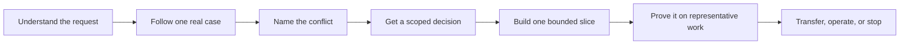

# The Applied AI Field Guide in Five Minutes

> Before you choose a model, find the work, evidence, and decision that matter.

A common Monday starts like this: “Build an agent that clears invoice exceptions.” By 9:40, the analyst has shown you three queues, an unmentioned spreadsheet, and a controller-only policy check. The request described one workflow. The work has four. Sometimes the brief is wrong. Sometimes the data, design, evaluation, or operating path is the problem.

Don't open the architecture diagram yet. Find what actually happens, who decides, and what would make the result acceptable.

This page is guidance—not production approval, customer authority, or a substitute for the target organization's policy, security, architecture, and risk review.

## Start with today's job

| You need to… | Do this next | Leave the first pass with |
| --- | --- | --- |
| **Choose what to fund** | Compare the next proof each workflow needs and what it would cost. Start with the [executive funding guide](funding-ai-for-accepted-outcomes.md). | A funded test, an accountable owner, and a reason to hold the other work |
| **Review an inherited application** | Check what the current platform and configuration already prove, then test what this workflow adds. Use the [application and platform baseline](../templates/production-service-readiness.md#application-and-platform-baseline). | Evidence you can reuse, checks still needed, and a trigger to revisit them |
| **Decide where AI could help** | Follow one recent case, define the decision and accepted outcome, then compare rules, retrieval, models, agents, and human review. Start with [Discovery and Value](../playbooks/01-discovery-and-value.md). | An observed decision, verifier, baseline, and smallest plausible mechanism |
| **Build or repair an AI feature** | Bound one vertical slice through the real source, user surface, failure path, and owner. Use [Solution and Delivery](../playbooks/02-solution-and-delivery.md) and the [invoice review lab](../examples/invoice-exception/document-review/README.md). | One testable path, explicit exclusions, and a result a user can inspect or reject |
| **Find why retrieval or answers are weak** | Separate retrieval, source support, permissions, freshness, and abstention. Use [Context and Knowledge Systems](../library/02-context-and-knowledge-systems.md) and the [retrieval lab](../examples/invoice-exception/retrieval-evaluation/README.md). | A failed case tied to the layer that owns the repair |
| **Prepare a release or material change** | Test the exact behavior and dependency versions, then name rollout and rollback conditions. Use the [release gates](../operations/release-gates.md). | A bounded release claim and the evidence still missing |
| **The brief doesn't match the work** | Preserve what was promised or requested, then follow one recent case with the person who handled it. Use the [field-engagement playbook](../playbooks/00-field-engagement-and-reframing.md). | The inherited claim, the observed reality, and the next decision written separately |
| **Staff the next test** | Use the [staffing view](capability-roadmap.md#staff-the-workflow-you-have) to check actual availability and separation of duties. | Named people, decision rights, reviewer time, and a backup |
| **Something was built, but nobody will accept or own it** | Stop adding features. Check acceptance evidence, operating ownership, rollback, support, and transfer with [production readiness](../templates/production-service-readiness.md) and the [customer handoff](../templates/customer-enablement-handoff.md). | A named gap, owner, and decision to repair, constrain, transfer, pause, or retire |

For a quick result you can inspect, [replay interrupted invoice work](../examples/invoice-exception/durable-recovery/README.md#run-it). Expect four stored-effect counts in order: `1, 0, 0, 1`. Then [open the browser review exercise](../examples/invoice-exception/document-review/practice.md#round-2-observe-difficult-documents), correct one draft, and export the practice record. Both paths work with synthetic inputs and no model key.

## Before you design anything

Ask the person who does or repairs the work to show you a recent exception. Watch the handoffs, judgment calls, policy checks, and quiet workarounds.

Keep evidence separate: what sponsors say, operators do, systems enforce, and policy authorizes. Inspect relevant code or configuration, data, permissions, and one representative execution. Questionnaires and maturity scores don't prove readiness.

Now write the conflict in plain English. For example:

> **Inherited brief:** the agent approves invoice exceptions automatically.
>
> **Observed:** four of the last twenty cases needed controller judgment, and the policy source changes outside the workflow tool.
>
> **Safe fallback:** prepare a cited recommendation; don't approve or post anything.
>
> **Decision needed:** whether to test that bounded review path for two weeks.

Use the [reframe record](../templates/engagement-reframe.json) to preserve the brief and ask the right owner to decide.

This is a compressed field path, not the [canonical lifecycle](../README.md#from-idea-to-production).

## Once the boundary is real

Before choosing a mechanism, write down eligible work, baseline, outcome, owner, verifier, deadline, cost ceiling, and when to stop.

If nobody with authority can accept the outcome, you're still in discovery.

Then split the workflow into decisions. A rule may handle eligibility. Retrieval may find the governing passage. A model may draft a comparison. A person may still own the judgment. Compare deterministic software, optimization, classical machine learning, retrieval, a bounded model call, an agent workflow, and human review as relevant. Use the simplest route that meets the need.

The model can propose. It can't grant itself permission or prove that an effect occurred. Trusted software has to enforce identity, tenant, scope, policy, approval, duplicate safety, and effect limits. For a consequential action, read the result back from the authoritative system before telling anyone it is done.

## Prove the service people will actually run

A tidy happy path isn't enough. Test normal work, exceptions, stale sources, dependency failures, policy changes, recovery, reviewer capacity, cost, and latency. Bind the result to the exact data, behavior, tools, software, and policy versions that ran.

Watch the human side too. Can the operator understand the evidence? Does review fit inside the day? Are people correcting, bypassing, or abandoning the system?

Before launch, use the [release gates](../operations/release-gates.md) to name the operating owner, telemetry, support route, rollback trigger, change process, and retirement conditions. A canary without somebody watching it is just a smaller unattended release.

## Make ownership survive the project

The people running the service need to operate, evaluate, release, change, recover, support, and retire it. Practice those jobs during the pilot. Don't wait until the last week to discover that only the original builder can change a rule or restore a failed job.

An internal team may keep ownership; give it capacity and backup coverage. A temporary FDE team should agree on exit evidence and transfer ordinary implementation or support once the important uncertainty is resolved. Neither arrangement should depend on one person's laptop or permanent availability.

Track eligible work through exposure, completion, acceptance, and effect. Fix the first break.

## Keep the working packet small

Create only the evidence needed for the next consequential decision:

- an [observation log](../templates/field-observation-log.md) for what happened in the work;
- an [engagement reframe](../templates/engagement-reframe.json) when field evidence contradicts the brief;
- a [workflow charter](../templates/workflow-charter.json) and [value case](../templates/value-case.md) once the boundary is credible;
- an [intelligence-selection record](../templates/intelligence-selection-record.md) before committing to a mechanism;
- representative [evaluation cases](../templates/evaluation-case.json) before making a release claim;
- [production readiness](../templates/production-service-readiness.md) and [handoff evidence](../templates/customer-enablement-handoff.md) before launch or a change of owner.

Skip artifacts that don't help someone make, verify, operate, or revisit a decision.

## Where to go next

Still reconciling the brief? Continue with [Field Engagement and Accountable Reframing](../playbooks/00-field-engagement-and-reframing.md). If the workflow boundary is accepted and you need the full mental model, read the [concise Applied AI Field Guide](README.md). If you're designing or reviewing the implementation, move into the [lifecycle playbooks](../playbooks/README.md) and [Engineering Kit](../examples/invoice-exception/README.md).

The Guide is a design and verification kit, not a runtime, certification, or universal compliance standard. Complete templates and teaching systems aren't customer evidence. Target-system policy, source authority, human decisions, and inspectable release evidence still control what may ship.
